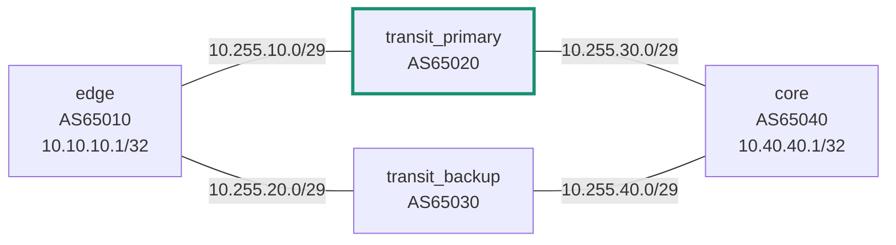

# BGP Routing Laboratory

**A reproducible four-AS routing and failover lab built with FRRouting, Docker Compose, and Python.**

> Portfolio project. This is a controlled network engineering lab, **not** production or commercial HFT operations experience. The repository does not claim real-world nanosecond latency or production-grade failover.

## What it demonstrates

- Four private autonomous systems with bidirectional eBGP peering (AS65010, AS65020, AS65030 and AS65040).
- An active/standby choice between two independent transit ASes through inbound **Local Preference**.
- Explicit, allowlist-only inbound and outbound BGP route maps and prefix lists, with a repeatable unauthorized-prefix injection test.
- A deterministic primary transit container outage, automatic router recovery, and BGP control-plane path observation.
- JSON-driven checks of eight directional neighbor perspectives, bestpath selection, and two-way sourced ICMP.
- Structured diagnostic snapshots and evidence files kept outside version control.
- Unit tests and CI for configuration invariants and JSON parsing; an optional manually triggered Docker integration workflow.

## Topology



The Docker bridge reserves `.1` as gateway on every `/29` link. Only `.2` and `.3` are assigned to the routers. The 10.10.10.1/32 and 10.40.40.1/32 service IPs are installed on router loopback interfaces by FRRouting (`zebra`). No host port is published. Each per-link bridge is user-defined with NAT masquerading disabled (`enable_ip_masquerade: false`). The intended route for the core service from `edge` is **via 10.255.10.3**, falling back to **10.255.20.3** if `transit_primary` disappears.

| Router | AS | Neighbors and interface addresses | Originated service prefix |
|---|---:|---|---|
| edge | 65010 | primary 10.255.10.2; backup 10.255.20.2 | 10.10.10.1/32 |
| transit_primary | 65020 | edge 10.255.10.3; core 10.255.30.2 | none |
| transit_backup | 65030 | edge 10.255.20.3; core 10.255.40.2 | none |
| core | 65040 | primary 10.255.30.3; backup 10.255.40.3 | 10.40.40.1/32 |

## Requirements

- Windows 11 + Docker Desktop running with the WSL2 backend and Linux containers (or Docker Engine with Compose v2 on Linux).
- About 1–2 GB available for FRR container images and four small containers; exact space varies.
- Optional: Python 3.10+ to run the CLI and tests. The Python controller uses **only the standard library**.
- No Linux installation on the Windows host, Windows routing changes, Docker host networking, or privileged containers are required by the lab. Docker Desktop already provides its own Linux environment.

**Do not** enable `host` networking or run commands as Windows Administrator for this project. `NET_ADMIN`, `NET_RAW`, and `SYS_ADMIN` are capabilities granted **inside the lab containers**, as documented for FRR's routing daemons; they are not Windows administrator privileges.

## Quick start — PowerShell

From the extracted project folder:

```powershell
# Optional Docker check
 docker version
 docker compose -f compose.yaml config --quiet

# Start only this lab
 docker compose -f compose.yaml up -d

# Show the BGP neighbors on the edge router
 docker compose -f compose.yaml exec edge vtysh -c "show bgp ipv4 unicast summary"

# Examine both candidate paths for the remote service
 docker compose -f compose.yaml exec edge vtysh -c "show bgp ipv4 unicast 10.40.40.1/32"

# Tear down only this lab when finished
 docker compose -f compose.yaml down
```

If Python is installed, the **recommended** automated validation path is:

```powershell
py -3 .\scripts\labctl.py preflight
py -3 .\scripts\labctl.py up
py -3 .\scripts\labctl.py check --timeout 120
# Run failover and filter ONLY AFTER check passes fully
py -3 .\scripts\labctl.py failover --timeout 120
py -3 .\scripts\labctl.py filter --timeout 120
py -3 .\scripts\labctl.py collect
py -3 .\scripts\labctl.py down
```

`failover` stops only the primary-transit container belonging to this Compose project and starts it again in a `finally` block. If your terminal loses power, use `py -3 .\scripts\labctl.py up` to restore all services. The test uses **real** observed state from FRRouting once it is run; it never fabricates convergence times.

## Tests

```powershell
py -3 -m unittest discover -s tests -v
```

This runs deterministic offline unit/static tests. **It does not establish BGP sessions.** For real integration, run `check`, `failover`, and `filter` against Docker. CI has a separate *Docker BGP integration (manual)* GitHub Actions workflow; passing unit tests must not be presented as passing integration tests.

## Diagnostics

```powershell
# FRRouting shell
 docker compose -f compose.yaml exec edge vtysh

# Host-side container status (no changes to host routing)
 docker compose -f compose.yaml ps

# Interface addresses inside an isolated router
 docker compose -f compose.yaml exec edge ip -4 addr

# Kernel routes inside a router
 docker compose -f compose.yaml exec edge ip -4 route

# FRR diagnostic snapshots into artifacts/ (ignored by Git)
 py -3 .\scripts\labctl.py collect
```

The evidence under `artifacts/` is automatically excluded by `.gitignore`. If results are published, explain where and when they were gathered, Docker Desktop version, FRR version, and the observed environment. Never claim production jitter or packet forwarding latency from the BGP failover experiment.

## Repository layout

```text
compose.yaml                Four FRRouting routers + Docker-local bridges (no NAT)
configs/<router>/           Explicit frr.conf, daemons and vtysh.conf
scripts/labctl.py           Reproducible experiments, diagnostics, local evidence bundling
scripts/verify_evidence.py Offline verification of real user-provided runtime evidence
scripts/Start-Lab.ps1       PowerShell starter
scripts/Stop-Lab.ps1        PowerShell cleanup
tests/                     Unit tests, structural invariants and JSON fixtures
docs/architecture.md        Address plan and routing policies
docs/runbook.md             Operations and troubleshooting
docs/validation.md          Verified local vs pending CI validation, evidence checklist
docs/field-report-2026-10-27.md  Inspected user JSON and screenshot results, limitations
docs/evidence-summary-2026-10-27.json  Sanitized observed results and SHA-256 checksums
docs/interview-notes.md     Design tradeoffs, interview defense
docs/github-publishing.md  Publication checklist with safe Git commands
.github/workflows/         Static CI and manually run integration tests
```

## Security and limits

This is a **private simulation**. RFC 6996 private ASNs and laboratory addresses are not publicly advertised. BGP authentication, RPKI, BFD, ECMP, high-resolution kernel timestamps and high-availability control planes are intentionally out of scope for v1. The topology runs in container namespaces, with no published ports. Docker bridge networks remain locally accessible to the Docker Engine host. Forwarding under Docker Desktop networking is not representative of physical NIC or HFT infrastructure latency.

## Sources

- FRRouting [BGP guide and JSON commands](https://docs.frrouting.org/en/stable-10.7/bgp.html)
- FRRouting [daemon configuration](https://docs.frrouting.org/en/latest/setup.html)
- FRRouting [route maps](https://docs.frrouting.org/en/latest/routemap.html)
- FRRouting [release images](https://frrouting.org/release/)
- Docker [Compose networking](https://docs.docker.com/compose/how-tos/networking/)

## Independently reviewed runtime evidence (2026-10-27)

The user supplied the original four JSON evidence files from v0.2 after the workstation experiments. Version v0.4 independently parses and validates the **supplied JSON's internal consistency**: eight Established directional BGP peer perspectives, primary/backup path local-preference 200/100 and installed primary route reports, failover and export-policy test results. These files were not generated in the packaging environment. The complete raw snapshot stays outside the public ZIP; the SHA-256 provenance and evaluated claims are available in [the derived evidence summary](docs/evidence-summary-2026-10-27.json).

```powershell
# Run against the separate, original private ZIP (if present):
py -3 .\scripts\verify_evidence.py .\artifacts\BGP_Evidence_v0.2.zip
```

The verification code is included in [`scripts/verify_evidence.py`](scripts/verify_evidence.py) and tested against explicitly synthetic fixtures. No claims about packet-level outage duration or HFT hardware latency are derived from this evidence.

## Verified local result (2026-10-27)

**Four-router topology validated on the user's Windows 11 / Docker Desktop v0.2 environment.** PowerShell screenshots show four containers started and these local integration experiments passed:

- Baseline: eight directional eBGP neighbor checks Established, primary-path choice on both endpoints, two-way sourced ICMP.
- Primary transit outage: both endpoints selected the backup path, loopback-to-loopback ICMP passed; after restoration the primary path and connectivity returned.
- Unauthorized route injection: `198.18.0.1/32` originated at the primary transit router and was not observed at edge/core after the test observation interval.
- `collect`: snapshot of all four routers saved on the user's workstation.

See [the dated field report](docs/field-report-2026-10-27.md), [derived evidence summary](docs/evidence-summary-2026-10-27.json), and [the validation matrix](docs/validation.md) for exact provenance and limitations. The full raw local JSON files are **not** included in the public release; their derived checked summary and original SHA-256 hashes are included. The separate GitHub-hosted integration workflow has **not** been verified. No hardware packet latency, jitter, sustained loss-rate, throughput, or precise outage duration has been measured.

### Export the four real JSON evidence files for review

On the original running v0.2 project folder, the files live in `artifacts/`. To use the v0.4 bundler, copy those JSON files into `artifacts/` of the extracted v0.4 folder and run:

```powershell
py -3 .\scripts\labctl.py bundle
```

The result is `artifacts/BGP_Evidence_<UTC-timestamp>.zip` with the unchanged local JSON and a SHA-256 manifest. **Inspect the JSON before sharing or publishing it.** The bundler performs no network measurements and does not touch Windows routing.

## Version history

- **v0.4 (2026-10-27):** Reviewed four original user-supplied JSON reports, added public sanitized provenance/validation summary, independent evidence verification CLI and unit tests. Working BGP routing files unchanged.

- **v0.3 (2026-10-27):** Documentation of the successful v0.2 workstation run, field report, verified claims table, and local evidence bundling command. Existing working Docker / FRR network configuration unchanged.
- **v0.2 (2026-10-27):** Docker Desktop ICMP forwarding remediation, read-only diagnosis command.
- **v0.1 (2026-10-27):** Four-router baseline; initial sourced ICMP failed on Windows Docker Desktop. Previous failure retained in the field report.

## Windows publisher fix

The GitHub publishing bundle includes a cross-platform byte-preservation regression test for evidence ZIPs. The fixed publisher package passes offline tests on Linux and is designed to avoid CRLF/LF mismatches on Windows; real Windows rerun still needs confirmation.
